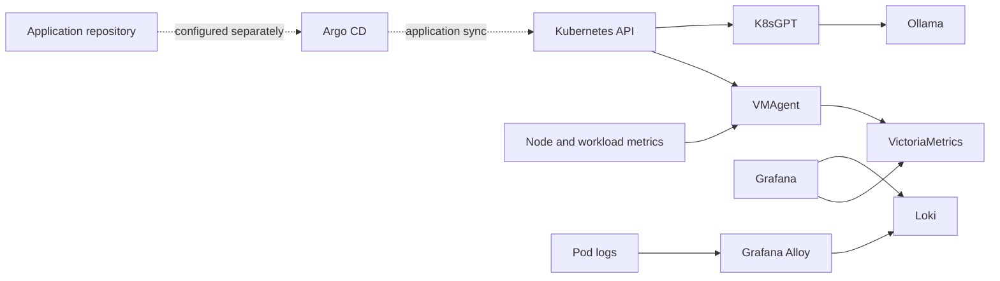

# Architecture and layout

[中文](architecture.md) · [Back to README](../README.en.md)

qwq-ops prepares an Ubuntu host as a single-node Kubernetes lab, then installs metrics, logging, application delivery, and cluster diagnostics. Scripts control deployment order, Helm values hold component settings, and Kubernetes manifests connect the components.

## Component responsibilities

| Layer | Components | Responsibility |
| --- | --- | --- |
| Cluster | kubeadm, containerd, Calico | Initialize the control plane, run containers, and provide Pod networking |
| Storage | Local Path Provisioner | Allocate directories on the node for PVCs |
| Metrics | VictoriaMetrics, VMAgent, Grafana | Collect, store, and query metrics |
| Logs | Grafana Alloy, Loki | Collect Pod logs and store them for queries from Grafana |
| Application delivery | Argo CD | Provide an entry point for syncing applications from Git |
| Diagnostics | K8sGPT, Ollama | Analyze cluster resources and explain findings through a local model |

Arrows from Grafana represent queries; arrows from Alloy and VMAgent represent writes. After installing Argo CD, you still need to configure repositories, credentials, and Applications. Installing the platform does not put your workloads under Argo CD management.

K8sGPT findings help with investigation. This deployment does not automatically restart, delete, or modify workloads based on those findings. Model requests go to the in-cluster Ollama service, although installation still requires access to external package and image registries.

## Directory boundaries

| Path | Contents |
| --- | --- |
| `scripts/` | Deployment and verification entry points |
| `scripts/lib/` | Shared error handling, dependency checks, and command wrappers |
| `config/versions.env` | Pinned software and Helm chart versions |
| `config/helm/` | Separate Helm values for each component |
| `manifests/` | Project-maintained Kubernetes resources and integrations |
| `tests/` | Regression checks that do not require a real cluster |
| `.github/workflows/` | Automated checks for commits and pull requests |
| `docs/` | Architecture and operations documentation in Chinese and English |

For a new component, first decide whether Helm or a manifest owns it, then add its installation to the deployment entry point. Keep each setting in one place rather than duplicating it between scripts and values. Keep versions in the version file.

## Single-node tradeoffs

Local Path Provisioner stores data on the current node. Node failure, disk loss, or PVC deletion can cause data loss. It does not replicate data across nodes or replace backups. Adding nodes requires a separate decision about persistent storage.

Metrics, logs, and models share the host's CPU, memory, and disk. Loading and running a model affects other components. Retention periods and PVC sizes must fit available storage. The repository's resource settings are a starting point for a lab; measure capacity with your own workloads.

A single control plane and single-replica services do not provide high availability. Before using this setup for production workloads, design control plane redundancy, persistent storage, authentication, network policies, backup and recovery, and upgrades, then validate them in the target environment.

## Applying configuration

Run host initialization and storage setup before deploying the platform. The deployment entry point reads pinned versions and component values, waits for installation results, then applies integrations that depend on the installed resource types. Run the verification script last to inspect the current cluster.

Editing files in Git does not change the cluster automatically. Review the diff and back up data before applying changes through the corresponding script or command. The version file is not an upgrade tool for an existing Kubernetes cluster. See the [operations guide](operations.en.md) for details.
