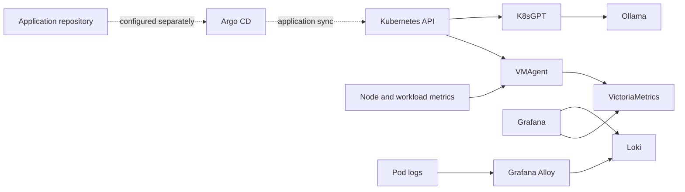

# 架构与目录

[English](architecture.en.md) · [返回首页](../README.md)

qwq-ops 把一台 Ubuntu 主机配置为单节点 Kubernetes 实验环境，再安装指标、日志、应用交付和集群诊断组件。脚本负责部署顺序，Helm values 负责组件参数，Kubernetes 清单负责组件之间的连接。

## 各层负责什么

| 层 | 组件 | 职责 |
| --- | --- | --- |
| 集群 | kubeadm、containerd、Calico | 初始化控制面，运行容器，提供 Pod 网络 |
| 存储 | Local Path Provisioner | 在节点磁盘上为 PVC 分配目录 |
| 指标 | VictoriaMetrics、VMAgent、Grafana | 采集、保存和查询指标 |
| 日志 | Grafana Alloy、Loki | 采集 Pod 日志并保存，供 Grafana 查询 |
| 应用交付 | Argo CD | 提供从 Git 同步应用的入口 |
| 诊断 | K8sGPT、Ollama | 分析集群资源，并通过本地模型解释结果 |

Grafana 的箭头表示查询，Alloy 和 VMAgent 的箭头表示写入。Argo CD 安装后仍需要配置仓库、凭据和 Application；安装平台本身不会把业务应用交给它管理。

K8sGPT 的结果用于辅助排查。当前部署不会根据诊断结果自动重启、删除或修改业务资源。模型请求留在集群内的 Ollama 服务，但集群仍需要访问外部软件仓库和镜像仓库来完成安装。

Ollama 将模型保存在 PVC 中，启动时优先使用已有模型，缺失时才下载。同名 tag 需要显式刷新，命令见[操作手册](operations.md#配置与预览)。

## 目录边界

| 路径 | 应放入的内容 |
| --- | --- |
| `scripts/` | 面向使用者的部署与检查入口 |
| `scripts/lib/` | 多个脚本共同使用的错误处理、依赖检查与命令封装 |
| `config/versions.env` | 软件与 Helm chart 的固定版本 |
| `config/helm/` | 按组件拆分的 Helm values |
| `manifests/` | 由项目维护的 Kubernetes 资源与集成配置 |
| `examples/` | 按需应用的实验资源，如临时告警规则 |
| `tests/` | 不需要真实集群的回归检查 |
| `.github/workflows/` | 在提交和 PR 上执行的自动检查 |
| `docs/` | 架构说明和操作手册，中文与英文对应维护 |

新增组件时，先确定它由 Helm 还是清单管理，再把安装顺序加入部署入口。不要同时在脚本和 values 中保存同一份配置；版本也只在版本文件中维护。

## 单节点的取舍

Local Path Provisioner 将数据保存在当前节点。节点损坏、磁盘丢失或删除 PVC 都可能造成数据丢失；它不提供跨节点复制，也不替代备份。增加节点后，需要重新选择持久化存储方案。

Loki 使用持久化卷保存日志；Alloy 的读取位置保存在容器临时目录，重建后可能重读仍可获取的日志，产生额外流量。

指标、日志和模型共享主机的 CPU、内存与磁盘。模型加载和推理会影响其他组件，保留期限与 PVC 大小也必须与磁盘容量一起调整。仓库里的资源设置是实验环境的起点，实际容量应通过自己的负载测量。

单个控制面和单副本服务不能提供高可用。若要承载正式业务，需要另外设计控制面冗余、持久化存储、访问认证、网络策略、备份恢复和升级流程，并在目标环境验证。

## 配置如何生效

先运行主机初始化与存储脚本，再运行平台部署脚本。部署入口读取固定版本和各组件 values，依次等待安装结果，再应用依赖已安装资源类型的集成配置。最后运行验证脚本检查当前集群状态。

修改 Git 中的文件不会自动更改集群。确认差异、备份数据后，使用对应脚本或命令应用变更；版本文件也不是现有 Kubernetes 集群的升级工具。操作细节见[操作手册](operations.md)。
